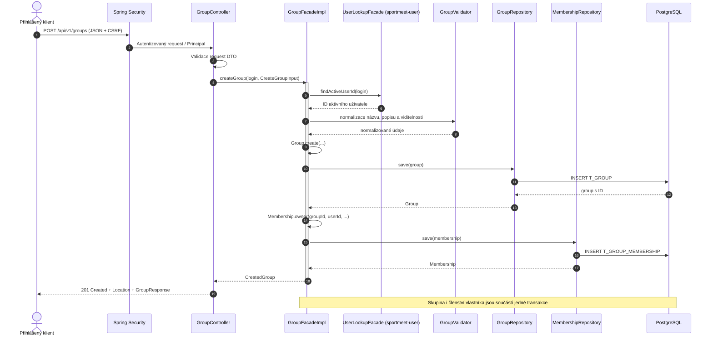

# sportmeet-group

## Účel modulu

`sportmeet-group` vlastní sportovní skupiny a členství uživatelů v nich. Aktuálně zajišťuje založení skupiny přihlášeným uživatelem, který se stává jejím jediným aktivním vlastníkem (`OWNER`), a ukládá skupinu spolu s členstvím v jedné transakci.

Modul obsahuje pravidla a data související se skupinami. Identitu přihlášeného uživatele získává výhradně přes veřejný kontrakt `cz.osu.sportmeet.user.api.lookup.UserLookupFacade` modulu `sportmeet-user`; do jeho interních balíčků nesahá. Konfiguraci Spring Security, HTTP session a CSRF spravuje `sportmeet-app`.

## Struktura a vrstvy

Základní package: `cz.osu.sportmeet.group`.

```text
src/
├── main/java/cz/osu/sportmeet/group/
│   ├── api/                         # REST controller, mapování chyb a DTO
│   │   └── dto/                     # HTTP request/response modely
│   ├── application/                 # Use casy, fasáda a její implementace
│   │   ├── dto/                     # Aplikační vstupy a výstupy
│   │   ├── exception/               # Aplikační výjimky
│   │   └── validation/              # Validace a normalizace údajů skupiny
│   ├── domain/                      # Viditelnost skupiny, role a stavy členství
│   └── persistence/                 # JPA model a databázový přístup
│       ├── entity/                  # Group, Membership
│       ├── repository/              # Spring Data repository
│       └── schema/                  # Názvy databázových objektů
└── test/java/.../group/             # Unit testy aplikační vrstvy a entit
```

| Vrstva | Odpovědnost |
|---|---|
| `api` | Přijetí HTTP požadavku, validace DTO, převod odpovědi, HTTP chyby |
| `application` | Koordinace use casů, transakce, validace a normalizace, práce s repository |
| `domain` | Viditelnost skupiny, role členů a životní cyklus členství |
| `persistence` | JPA entity `Group` a `Membership`, repository a názvy tabulek/sloupců |

Skupina (`Group`) a členství (`Membership`) jsou samostatné entity. Členství odkazuje na skupinu i uživatele pomocí ID, nikoliv JPA vazbou na interní entitu `User`. Technická platnost (`valid`) je nezávislá na viditelnosti skupiny (`PUBLIC`, `PRIVATE`) i stavu členství (`ACTIVE`, `ENDED`). Role člena jsou `OWNER`, `SECONDARY_OWNER` a `MEMBER`; při založení skupiny vzniká aktivní členství zakladatele s rolí `OWNER`.

## REST API

| Metoda | Endpoint | Účel |
|---|---|---|
| `POST` | `/api/v1/groups` | Založení nové skupiny přihlášeným uživatelem |

Endpoint vyžaduje přihlášení (session cookie `SESSION`) a CSRF token. Přihlášení, odhlášení a získání CSRF tokenu zajišťuje `sportmeet-app`, nikoliv tento modul.

Vlastník skupiny se **nikdy nebere z těla požadavku** – vždy pochází z autentizované session. Odpověď obsahuje pouze `id`, `name`, `description` a `visibility`. Detail požadavku, odpovědi a stavových kódů je v [dokumentaci REST API](../docs/REST_API.md).

## Hlavní komponenty

- `GroupController` – HTTP endpoint `/api/v1/groups`; přebírá přihlášeného uživatele z `Principal`.
- `GroupExceptionHandler` – převod chyb na `ProblemDetail`, platí pouze pro `GroupController`.
- `GroupFacade` / `GroupFacadeImpl` – use case založení skupiny, transakce a koordinace ostatních komponent.
- `GroupValidator` – ořezání a validace názvu a popisu, výchozí viditelnost.
- `InactiveUserException` – přihlášený uživatel již nemá aktivní účet.
- `Group`, `Membership` – JPA entity; tovární metody `Group.create()` a `Membership.owner()` vytvářejí platný počáteční stav.
- `GroupVisibility`, `MembershipRole`, `MembershipStatus` – doménové výčty.

## Závislosti a hranice

- Závisí na `sportmeet-common` (`InvalidInputException`, `DataInfo`, `MainDatabaseEntity`).
- Závisí na `sportmeet-user`, ale smí používat pouze veřejný kontrakt `cz.osu.sportmeet.user.api`; aktuálně `UserLookupFacade.findActiveUserId(login)`.
- Je používán modulem `sportmeet-app`, který ho sestavuje do spustitelné aplikace.
- Ostatní moduly nesmí přistupovat k balíčkům `group.application`, `group.domain` ani `group.persistence`. Pravidlo hlídá ArchUnit test `ArchitectureTest` v `sportmeet-app`.
- Ukládání skupin a členství patří tomuto modulu; SQL schéma je verzováno Flyway migracemi v `sportmeet-app`. PostgreSQL částečné unikátní indexy omezují aktivní členství uživatele ve skupině na jedno a aktivního hlavního vlastníka na nejvýše jednoho; testovací H2 tyto indexy nevytváří.
- Samotný modul se nespouští nezávisle.

## Testování

Modul obsahuje unit testy pro fasádu, validátor a entity `Group` a `Membership`. HTTP a databázové integrační testy v `sportmeet-app` ověřují založení skupiny, přihlášení, CSRF, rollback transakce a databázová omezení.

```bash
./mvnw -pl sportmeet-group -am test
```

Příznak `-am` sestaví i závislé Maven moduly. Na Windows použijte `mvnw.cmd`.

## Rozsah aktuální implementace

Je implementováno pouze zatím založení skupiny, při kterém lze zvolit `PUBLIC` nebo `PRIVATE` (výchozí).

## Průchod požadavku od REST API do databáze

### Založení skupiny (`POST /api/v1/groups`)

```text
HTTP POST /api/v1/groups (JSON + CSRF)
  → Spring Security ověří session a CSRF token
  → GroupController.createGroup() (Principal.getName())
  → CreateGroupRequest (Jakarta Bean Validation: name není prázdný)
  → CreateGroupInput (aplikační DTO)
  → GroupFacade / GroupFacadeImpl.createGroup()  [@Transactional]
  → UserLookupFacade.findActiveUserId() (přihlášený uživatel musí být platný a ACTIVE)
  → GroupValidator.normalizeName()/normalizeDescription()/resolveVisibility()
  → Group.create() (valid = true, autor = zakladatel)
  → GroupRepository.save() (Spring Data JPA / Hibernate)
  → PostgreSQL: T_GROUP
  → Membership.owner() (role OWNER, stav ACTIVE)
  → MembershipRepository.save()
  → PostgreSQL: T_GROUP_MEMBERSHIP (stejná transakce)
  → CreatedGroup → GroupResponse
  → HTTP 201 Created + Location: /api/v1/groups/{id}
```

Controller zpracovává pouze HTTP kontrakt; kontrola uživatele, validace a založení skupiny jsou v aplikační vrstvě. Entity `Group` a `Membership` zůstávají interní, klient dostává `GroupResponse`.

Jméno skupiny musí mít po ořezání 1–100 znaků, popis nejvýše 2000; prázdný popis se ukládá jako `null` a neuvedená viditelnost jako `PRIVATE`. V aplikační vrstvě se ověřuje aktivní účet před validací délek, takže uživatel zablokovaný po přihlášení nemůže skupinu založit.

Skupina a členství vlastníka se ukládají atomicky. Pokud selže uložení členství, transakce zruší i skupinu, takže nevznikne skupina bez vlastníka.

## Sekvenční diagram

Diagram ukazuje typický průchod požadavku přes vrstvy modulu. Je záměrně zjednodušený: neobsahuje každé mapování DTO ani chybové větve. Autentizační filtr a konfigurace Spring Security jsou součástí `sportmeet-app`.

### Založení skupiny



## Kde se dokumentuje veřejné API

Aktuální přehled všech backendových endpointů, typů parametrů, odpovědí a chyb je v [`docs/REST_API.md`](../docs/REST_API.md). Strojově čitelný kontrakt pro FE nástroje a API testování je v [`docs/openapi.yaml`](../docs/openapi.yaml). Při změně endpointu, DTO, autorizace nebo stavového kódu aktualizujte obě dokumentace v témže PR.
