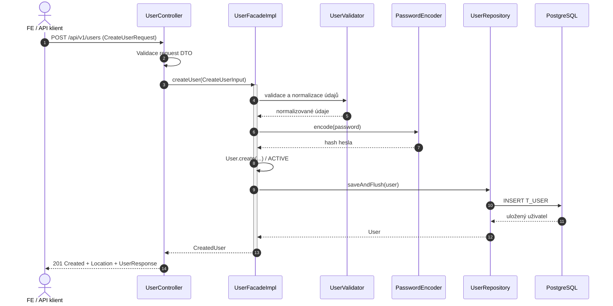
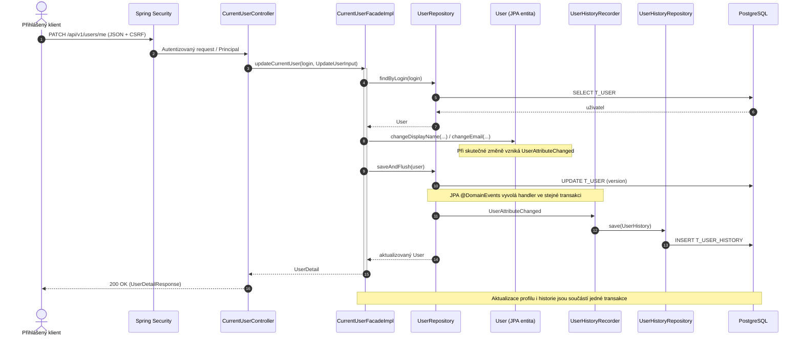

# sportmeet-user

## Účel modulu

`sportmeet-user` zajišťuje správu uživatelských účtů: registraci, načítání a úpravu vlastního profilu, poskytování přihlašovacích údajů bezpečnostní vrstvě a evidenci historie změn účtu.

Modul obsahuje pravidla a data související s uživatelem. Samotnou konfiguraci Spring Security, HTTP session a přihlašovací filtr spravuje `sportmeet-app`.

## Struktura a vrstvy

Základní package: `cz.osu.sportmeet.user`.

```text
src/
├── main/java/cz/osu/sportmeet/user/
│   ├── api/                         # REST controllery, DTO a mapování chyb
│   │   ├── authentication/          # Kontrakt pro autentizační integraci
│   │   └── dto/                     # HTTP request/response modely
│   ├── application/                 # Use casy, fasády a jejich implementace
│   │   ├── dto/                     # Aplikační vstupy a výstupy
│   │   ├── exception/               # Aplikační výjimky
│   │   └── validation/              # Validace uživatelských údajů
│   ├── domain/                      # Stavy, doménové pojmy a události
│   │   └── event/                   # Události změn uživatelského účtu
│   └── persistence/                 # JPA model a databázový přístup
│       ├── entity/                  # User, UserHistory
│       ├── repository/              # Spring Data repository
│       └── schema/                  # Názvy databázových objektů
└── test/java/.../user/             # Unit testy domény a aplikační vrstvy
```

| Vrstva | Odpovědnost |
|---|---|
| `api` | Přijetí HTTP požadavku, validace DTO, převod odpovědi, HTTP chyby |
| `application` | Koordinace use casů, transakce, validace a práce s repository |
| `domain` | Stavy účtu, význam změn a doménové události |
| `persistence` | JPA entity, repository a ukládání historie |

JPA entita `User` v aktuální implementaci obsahuje také chování pro úpravu údajů a publikaci doménových událostí. Rozdělení balíčků tedy neznamená, že doménová logika musí být pouze v `domain/`.

## REST API

| Metoda | Endpoint | Účel |
|---|---|---|
| `POST` | `/api/v1/users` | Registrace nového uživatele |
| `GET` | `/api/v1/users/me` | Detail přihlášeného uživatele |
| `PATCH` | `/api/v1/users/me` | Úprava vlastního profilu |
| `GET` | `/api/v1/users/me/history` | Stránkovaná historie změn účtu |

Přihlášení, odhlášení a pomocné autentizační endpointy zajišťuje `sportmeet-app`, nikoliv tento modul.

## Hlavní komponenty

- `UserFacade` / `UserFacadeImpl` – registrace uživatele.
- `CurrentUserFacade` / `CurrentUserFacadeImpl` – detail profilu, jeho úprava a historie.
- `UserAuthenticationFacade` / `UserAuthenticationFacadeImpl` – veřejný kontrakt pro získání přihlašovacích údajů bez přímého přístupu bezpečnostní konfigurace k repository.
- `UserValidator` – aplikační validace uživatelských údajů.
- `User`, `UserHistory` – aktuální stav účtu a historické záznamy.
- `UserAttributeChanged`, `UserHistoryRecorder` – zaznamenávání vybraných změn účtu.

## Závislosti a hranice

- Závisí na `sportmeet-common`.
- Je používán modulem `sportmeet-app`.
- Ostatní moduly mají přistupovat k uživatelské funkcionalitě prostřednictvím určených veřejných kontraktů, nikoliv přímo přes `UserRepository` a JPA entity.
- Ukládání uživatelských dat a historie patří tomuto modulu; SQL schéma je verzováno Flyway migracemi v `sportmeet-app`.
- Samotný uživatelský modul se nespouští nezávisle.

## Testování

Modul obsahuje unit testy pro fasády, validátor, entitu `User` a zaznamenávání historie. HTTP a databázové integrační testy jsou převážně v `sportmeet-app`.

```bash
./mvnw -pl sportmeet-user -am test
```

Příznak `-am` sestaví i závislé Maven moduly. Na Windows použijte `mvnw.cmd`.

## Rozsah aktuální implementace

Registrace vytváří aktivní účet bez potvrzování e-mailové adresy. Obnova zapomenutého hesla ani rate limiting nejsou v této verzi projektu součástí `sportmeet-user`; jde o plánované bezpečnostní rozšíření.

## Průchod požadavku od REST API do databáze

### Registrace uživatele (`POST /api/v1/users`)

```text
HTTP POST /api/v1/users (JSON)
  → UserController.createUser()
  → CreateUserRequest (Jakarta Bean Validation)
  → CreateUserInput (aplikační DTO)
  → UserFacade / UserFacadeImpl.createUser()  [@Transactional]
  → UserValidator.validateAndNormalize() (login a e-mail se normalizují)
  → User.create() (doménová pravidla a stav ACTIVE)
  → PasswordEncoder.encode() (BCrypt)
  → UserRepository.saveAndFlush() (Spring Data JPA / Hibernate)
  → PostgreSQL: T_USER
  → CreatedUser → UserResponse
  → HTTP 201 Created + Location: /api/v1/users/{id}
```

Controller pouze zpracovává HTTP kontrakt; validace a založení uživatele jsou v aplikační vrstvě. Entita `User` zůstává interní, klient dostává `UserResponse` bez hesla a bez hashe.

### Načtení profilu (`GET /api/v1/users/me`)

```text
HTTP GET /api/v1/users/me
  → Spring Security ověří existující session
  → CurrentUserController.me() (Principal.getName())
  → CurrentUserFacade / CurrentUserFacadeImpl.getCurrentUser() [readOnly transakce]
  → UserRepository.findByLogin()
  → PostgreSQL: T_USER
  → UserDetail → UserApiMapper → UserDetailResponse
  → HTTP 200 OK (JSON)
```

Název přihlášeného uživatele pochází ze serverové session, nikoli z parametru poslaného klientem. Aplikační služba navíc ověřuje, že je účet platný a `ACTIVE`.

### Aktualizace profilu a historie (`PATCH /api/v1/users/me`)

```text
HTTP PATCH /api/v1/users/me (JSON + CSRF)
  → CurrentUserController.update()
  → UpdateUserRequest → UserApiMapper → UpdateUserInput
  → CurrentUserFacadeImpl.updateCurrentUser() [@Transactional]
  → UserValidator (validace a normalizace)
  → UserRepository.findByLogin() → User.changeDisplayName()/changeEmail()
  → UserRepository.saveAndFlush() → JPA @DomainEvents
  → UserAttributeChanged → UserHistoryRecorder.on() [MANDATORY transakce]
  → UserHistoryRepository.save()
  → PostgreSQL: T_USER + T_USER_HISTORY (jedna transakce)
  → UserDetailResponse → HTTP 200 OK
```

Historie se zapisuje synchronně ve stejné databázové transakci jako změna profilu. Při selhání transakce se neuloží ani profil, ani historie. `@Version` na entitě `User` chrání proti souběžnému přepsání změn. Pokud klient odešle stejnou hodnotu jako již uloženou, změna se neprovádí a nevzniká nový historický záznam.

### Přihlášení (`POST /api/v1/auth/login`)

Přihlášení **nezpracovává `UserController`**. Standardní Spring Security filtr v `sportmeet-app` převezme form-data `login` a `password`, přes `SportMeetUserDetailsService` použije veřejné rozhraní `UserAuthenticationFacade` modulu `sportmeet-user`, načte uživatele a ověří heslo pomocí BCrypt. Výslednou autentizaci uloží prostřednictvím Spring Session JDBC do PostgreSQL. Detail tohoto procesu a pravidla CSRF jsou v [dokumentaci REST API](../docs/REST_API.md).

## Sekvenční diagramy

Diagramy ukazují typický průchod požadavku přes vrstvy modulu. Jsou záměrně zjednodušené: neobsahují každé mapování DTO ani všechny chybové větve. Autentizační filtr a konfigurace Spring Security jsou součástí `sportmeet-app`.

### Registrace uživatele



### Úprava profilu a zápis historie



## Kde se dokumentuje veřejné API

Aktuální přehled všech backendových endpointů, typů parametrů, odpovědí a chyb je v [`docs/REST_API.md`](../docs/REST_API.md). Strojově čitelný kontrakt pro FE nástroje a API testování je v [`docs/openapi.yaml`](../docs/openapi.yaml). Při změně endpointu, DTO, autorizace nebo stavového kódu aktualizujte obě dokumentace v témže PR.
