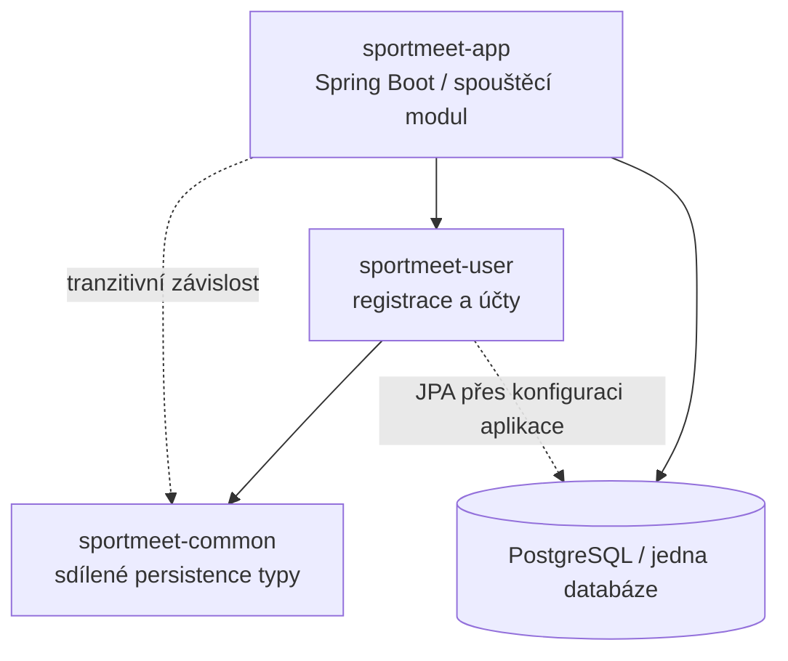
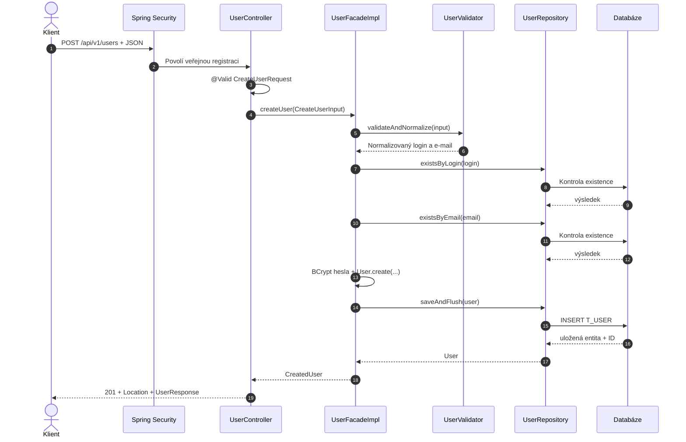
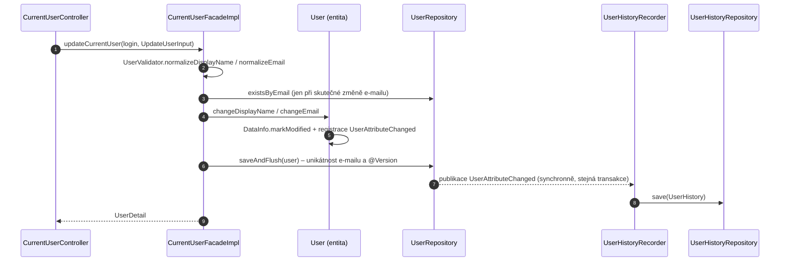
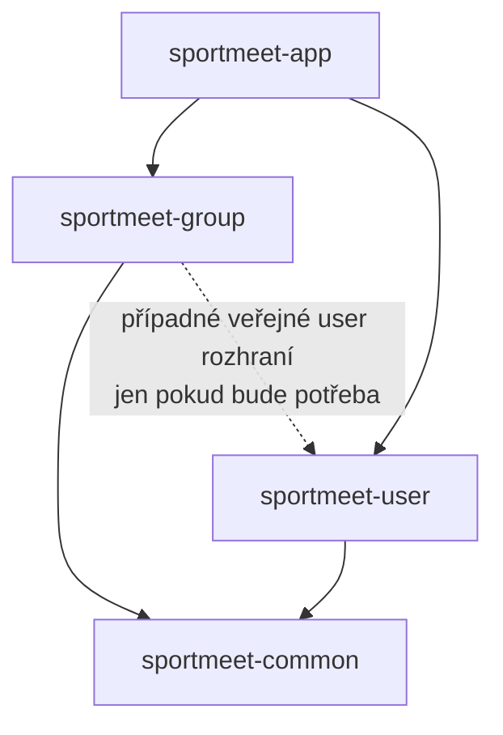
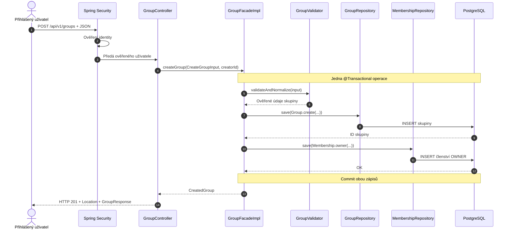
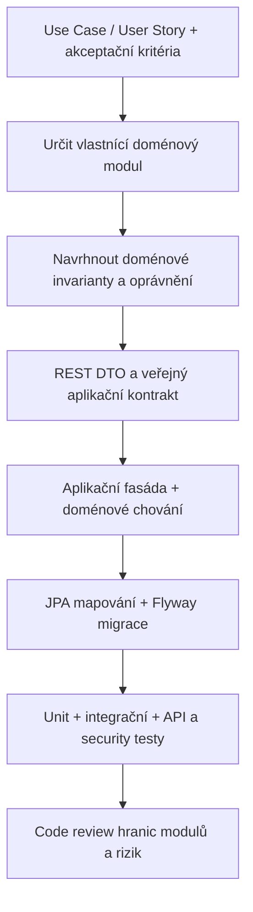

# SportMeet – aktuální implementace architektury a návod pro vývoj dalších funkcí

Máme jeden spustitelný Spring Boot backend, ale jeho kód je rozdělený do samostatných **Maven modulů podle doménových oblastí**.
Moduly nejsou mikroslužby: nemají samostatné servery ani vlastní procesy. Spring je při startu spojí do jednoho aplikačního kontextu
a používá jejich třídy přímo v JVM.

V každém doménovém modulu dále rozlišujeme technické odpovědnosti: **API** přijímá HTTP požadavky, **application** provádí scénář
použití a koordinuje pravidla, **domain** reprezentuje doménové pojmy a chování, **persistence** pracuje s databází. V současné
registraci je toto rozdělení praktické, nikoli striktní implementace čisté nebo hexagonální architektury: JPA entita `User` se
nachází v balíčku `persistence/entity` a aplikační fasáda ji přímo používá.

**Hlavní pravidlo:** Controller neimplementuje business proces a jiné moduly nesmějí obcházet veřejný kontrakt cizího modulu a
používat jeho interní repository nebo JPA entity.

### 1.1 Co už v projektu skutečně je

| Maven modul        | Stav           | Odpovědnost                                                                     |
|--------------------|----------------|---------------------------------------------------------------------------------|
| `sportmeet-app`    | Implementováno | Spouštěcí bod, bezpečnostní konfigurace, DB konfigurace, Flyway migrace a testy |
| `sportmeet-user`   | Implementováno | Registrace uživatele, validace, kontrola duplicit, hashování hesla, perzistence |
| `sportmeet-common` | Implementováno | Sdílené persistence kontrakty, auditní metadata a konstanty                     |

Použité technologie podle skutečných `pom.xml`: **Java 25**, **Spring Boot 4.1.1**, Spring MVC, Spring Security, Spring Data
JPA/Hibernate, PostgreSQL, Flyway, Maven, Lombok, JSpecify, Guava a testovací knihovny JUnit/Mockito/AssertJ. H2 se používá v
testovací konfiguraci.

### 1.2 Závislosti Maven modulů



Maven zajišťuje pořadí sestavení a vyhodnocení závislostí. Samotný Maven ale **nezabrání každému nevhodnému přístupu do interních
balíčků** jiného modulu, pokud jsou třídy veřejné a modul je na classpath. Hranice je nutné chránit návrhem API, code review a
případně architektonickými testy.

**Přesná odpověď na otázku „proč to není mikroservisní architektura?“:** všechny tři Maven moduly jsou knihovny sestavené do jedné
běžící aplikace; interní komunikace je volání metod, nikoliv REST/gRPC mezi službami.

## 2. Jak je projekt fyzicky uspořádaný

```text
SportMeet/
├── pom.xml                              # parent + Maven aggregator
├── mvnw, mvnw.cmd                       # Maven Wrapper
├── sportmeet-app/
│   ├── pom.xml                          # Spring Boot a běhové závislosti
│   └── src/
│       ├── main/
│       │   ├── java/cz/osu/sportmeet/
│       │   │   ├── SportMeetApplication.java
│       │   │   └── config/SecurityConfiguration.java
│       │   └── resources/
│       │       ├── application.properties
│       │       └── db/migration/
│       │           ├── V1__initialize_database.sql
│       │           ├── V2__create_user.sql
│       │           ├── V3__create_spring_session.sql
│       │           └── V4__create_user_history.sql
│       └── test/                         # testy registrace, persistence, konfigurace
├── sportmeet-user/
│   ├── pom.xml
│   └── src/main/java/cz/osu/sportmeet/user/
│       ├── api/
│       │   ├── UserController.java
│       │   ├── UserExceptionHandler.java
│       │   ├── CurrentUserController.java
│       │   ├── CurrentUserExceptionHandler.java
│       │   ├── UserApiMapper.java
│       │   └── dto/
│       │       ├── CreateUserRequest.java
│       │       ├── UserResponse.java
│       │       ├── UserDetailResponse.java
│       │       ├── UpdateUserRequest.java
│       │       └── HistoryEntryResponse.java
│       ├── application/
│       │   ├── UserFacade.java
│       │   ├── UserFacadeImpl.java
│       │   ├── CurrentUserFacade.java
│       │   ├── CurrentUserFacadeImpl.java
│       │   ├── UserAuthenticationFacade.java
│       │   ├── UserAuthenticationFacadeImpl.java
│       │   ├── UserHistoryRecorder.java
│       │   ├── dto/
│       │   │   ├── CreateUserInput.java
│       │   │   ├── CreatedUser.java
│       │   │   ├── UserDetail.java
│       │   │   ├── UpdateUserInput.java
│       │   │   ├── UserCredentials.java
│       │   │   └── UserHistoryEntry.java
│       │   ├── exception/
│       │   │   ├── DuplicateEmailException.java
│       │   │   └── DuplicateLoginException.java
│       │   └── validation/UserValidator.java
│       ├── domain/UserState.java
│       └── persistence/
│           ├── entity/User.java
│           ├── repository/UserRepository.java
│           └── schema/UserSchema.java
└── sportmeet-common/
    └── src/main/java/cz/osu/sportmeet/common/persistence/
        ├── DataInfo.java
        ├── DataInfoObjectType.java
        ├── DataInfoSchema.java
        ├── DatabaseConstants.java
        ├── DatabaseEntity.java
        └── MainDatabaseEntity.java
```

**Parent `pom.xml`** má `packaging=pom` a deklaruje podmoduly. **`sportmeet-app`** používá `spring-boot-maven-plugin` a je
spustitelnou aplikací. `sportmeet-user` závisí na `sportmeet-common`; `sportmeet-app` závisí na `sportmeet-user`. Nejde o tři
samostatně nasazované Spring Boot servery.

`@SpringBootApplication` je na třídě `cz.osu.sportmeet.SportMeetApplication`. Spring Boot standardně prohledává její balíček a
podbalíčky, proto najde i controller, service, validator a repository z jiného Maven modulu pod `cz.osu.sportmeet.user`. Pro
Spring je rozhodující classpath a package scanning, nikoli název Maven modulu.

## 3. Registrace uživatele

### 3.1 Průchod HTTP požadavku

**Implementováno:** `POST /api/v1/users`. Endpoint je veřejný. Při úspěchu vrací **HTTP 201 Created**, JSON s identifikátorem,
loginem, zobrazovaným jménem, e-mailem a stavem účtu a hlavičku `Location` s cestou `/api/v1/users/{id}`. Tato cesta je v
odpovědi sestavená, ale GET endpoint pro ni zatím implementovaný není.



Zjednodušení diagramu: diagram zachycuje úspěšnou cestu; transakční proxy Springu obaluje volání metody označené `@Transactional` a
na konci provede commit. Při neúspěchu se vrací odpovídající chyba a transakce se v běžném případě vrátí zpět.

### 3.2 Kdo za co odpovídá

| Konstrukce              | Konkrétní třída        | Proč existuje                                                      |
|-------------------------|------------------------|--------------------------------------------------------------------|
| REST Controller         | `UserController`       | HTTP vstup, převod DTO, HTTP status a `Location`                   |
| Request DTO             | `CreateUserRequest`    | Tvar příchozího JSON; základní Bean Validation                     |
| Aplikační vstup         | `CreateUserInput`      | Data pro use case, nezávislá na HTTP request typu                  |
| Fasádní kontrakt        | `UserFacade`           | Veřejná vstupní operace aplikační vrstvy                           |
| Implementace fasády     | `UserFacadeImpl`       | Orchestrace registrace, transakce, kontrola unikátnosti, hashování |
| Validátor               | `UserValidator`        | Normalizace a pravidla nezávislá na transportu                     |
| JPA entita              | `User`                 | Persistentní stav a factory metoda pro vytvoření platného objektu  |
| Repository              | `UserRepository`       | Databázový přístup přes Spring Data JPA                            |
| Výstup aplikační vrstvy | `CreatedUser`          | Bezpečný výsledek use casu bez hesla/hashů                         |
| Response DTO            | `UserResponse`         | Explicitní veřejný formát REST odpovědi                            |
| Exception handler       | `UserExceptionHandler` | Převod chyb na HTTP Problem Details                                |

### 3.3 Controller – pouze transportní odpovědnost

`UserController` má `@RestController` a `@RequestMapping("/api/v1/users")`; metoda `createUser` má `@PostMapping`. Spring
deserializuje JSON přes `@RequestBody`, `@Valid` spouští Bean Validation, controller převede request na `CreateUserInput`, zavolá
`UserFacade` a výsledek převede na `UserResponse`.

Záměrně zde **není** kontrola, zda login existuje, ani práce s heslem nebo databází. Controller nemá záviset na `UserRepository`.
Tím zůstává HTTP vrstva tenká a stejný use case může případně využít i jiný vstupní kanál.

**Proč dvě dvojice DTO?** `CreateUserRequest`/`UserResponse` jsou kontrakt HTTP API; `CreateUserInput`/`CreatedUser` jsou kontrakt
use casu. Oddělení má cenu, když brání pronikání HTTP specifik do aplikační logiky. Není však nutné ho mechanicky vynucovat pro
každou triviální pomocnou strukturu.

### 3.4 Fasáda a její implementace

`UserFacade` je Java interface s metodou `CreatedUser createUser(CreateUserInput input)`. `UserFacadeImpl` je `@Service` s
konstruktorovou injekcí `UserRepository`, `UserValidator` a Spring Security `PasswordEncoder`.

Pořadí úkonů v `UserFacadeImpl.createUser(...)`:

1. Ověří nenulový vstup pomocí `Preconditions.checkNotNull`.
2. Nechá `UserValidator` ověřit a normalizovat hodnoty.
3. Dotáže se na existující login a e-mail; při konfliktu vyhodí typovanou výjimku.
4. Zahashuje heslo metodou `passwordEncoder.encode(...)`.
5. Pomocí `User.create(...)` vytvoří novou JPA entitu v počátečním stavu `ACTIVE`, `valid=true`.
6. Uloží ji metodou `userRepository.saveAndFlush(...)`.
7. Vrátí `CreatedUser` s bezpečně vybranými poli.

Metoda je označená `@Transactional`: jde o **hranici jedné operace**, nikoli o transakci pro každý jednotlivý repository dotaz. U
`saveAndFlush` se SQL odešle před návratem z fasády, ale **flush není commit**. Unikátní omezení databáze je důležité i přes
předchozí `existsBy...` kontroly, protože dva souběžné požadavky mohou mezi kontrolou a zápisem závodit.

### 3.5 Validace a normalizace nejsou totéž

`CreateUserRequest` provádí jednoduché kontroly (`@NotBlank`, `@Size`), ale `UserValidator` v aplikační vrstvě aplikuje další
pravidla:

- login: `strip()` a lowercase pomocí `Locale.ROOT`, délka 2–80 znaků;
- e-mail: `strip()`, lowercase, základní kontrola formátu a délka nejvýše 254 znaků;
- zobrazované jméno: `strip()`, požadavek na neprázdnou hodnotu, nejvýše 255 znaků;
- heslo: nejméně 8 znaků, maximálně 72 bajtů v UTF-8 (odpovídá omezení použitého BCrypt přístupu).

Proč je aplikační validace i vedle `@Valid`? Aplikační fasáda může být volána mimo HTTP controller (např. testem nebo budoucí
interní operací). Její správnost nesmí záviset na tom, zda vstupní adapter použil Bean Validation. Normalizace také zaručuje
konzistentní tvar loginu a e-mailu před vyhledáním a uložením.

### 3.6 Doménová reprezentace a persistence

`UserState` je enum `ACTIVE`, `DISABLED`, `BLOCKED`. `User` je JPA entita označená `@Entity`, `@Table`, `@Id`,
`@GeneratedValue(IDENTITY)`, `@Column`, `@Enumerated(STRING)`, `@Embedded` a `@Version`. Obsahuje také `DataInfo` pro auditní
metadata.

`User.create(...)` je **statická factory metoda**: nastaví výchozí stav, technickou platnost a audit založení. Díky ní nemusí fasáda
plnit mnoho setterů a entita vzniká v konzistentním počátečním stavu. Protected bezparametrický konstruktor generuje Lombok kvůli
JPA.

`@Version` je základ pro **optimistic locking**: při souběžné změně stejného záznamu může Hibernate detekovat zastaralou verzi a
zabránit tichému přepsání. U registrace se tato vlastnost aktuálně prakticky neprojevuje, ale dává smysl pro budoucí aktualizace
účtu.

`UserRepository extends JpaRepository<User, Long>` používá **Spring Data derived queries**: z názvů `existsByLogin` a
`existsByEmail` Spring sestaví příslušné dotazy. `saveAndFlush` je zděděná metoda. Není potřeba ručně psát jednoduché CRUD SQL.

`UserSchema` je `@UtilityClass` s konstantami názvů tabulky a sloupců (`T_USER`, `LOGIN` atd.). Zmenšuje riziko překlepů v JPA
mapování. Pozor: konstanty samy nevytvářejí schéma – to dělá Flyway migrace.

### 3.7 Audit, historie, soft delete – co je reálně hotové

`DataInfo` je `@Embeddable` – několik auditních sloupců tvoří v entitě jeden znovupoužitelný hodnotový objekt. Sleduje čas a původce
založení, případně poslední modifikace. Původce má typ `USER` nebo `SYSTEM`; veřejná registrace se ukládá jako vytvořená systémem.
Metoda `markModified` kontroluje také konzistenci času a identity původce.

**Důležitý rozdíl:** `DataInfo` uchovává metadata o založení a poslední změně, **není to úplná historie všech změn**. Historii
sledovaných změn atributů účtu vede modul `user` v tabulce `T_USER_HISTORY` (viz kapitola 3.11); Envers se v projektu nepoužívá.

`User.valid` umožňuje reprezentovat technickou platnost záznamu, ale zatím chybí kompletní use case deaktivace/reactivace. Unikátní
login i e-mail jsou rezervovány také neplatnými účty – takto funguje současná migrace a testy.

### 3.8 Jak vzniká tabulka v databázi

`spring.flyway.enabled=true`, `spring.jpa.hibernate.ddl-auto=validate`. Schéma tedy vytváří **Flyway**, zatímco Hibernate mapování
pouze kontroluje. `V1__initialize_database.sql` obsahuje jen `SELECT 1`; `V2__create_user.sql` zakládá `T_USER` s ID typu
`BIGINT GENERATED ALWAYS AS IDENTITY`, loginem, e-mailem, hashovaným heslem, stavem, `VALID`, auditními sloupci a `VERSION`.

Migrace obsahuje zejména:

- primární klíč;
- unikátnost `LOGIN` a `EMAIL`;
- `NOT NULL` omezení;
- `CHECK` pro možné stavy uživatele a typy aktérů.

S migrací je spojená i verzovací disciplína: **již aplikovanou migraci ve sdílené databázi nepřepisujeme; změny jdou do další
migrační verze**. Současná implementace navíc používá tabulku `T_USER` a ID `BIGINT`, což je nutné respektovat při návaznosti
dalších modulů.

### 3.9 Zpracování chyb REST API

`UserExceptionHandler` je `@RestControllerAdvice(assignableTypes = UserController.class)`. Pro tento controller mapuje:

| Situace                                    | HTTP                        | Podoba odpovědi                                   |
|--------------------------------------------|-----------------------------|---------------------------------------------------|
| Úspěšná registrace                         | `201 Created`               | `UserResponse`, hlavička `Location`               |
| Existující login nebo e-mail               | `409 Conflict`              | `ProblemDetail`                                   |
| DB konflikt unikátního loginu nebo e-mailu | `409 Conflict`              | Typovaná aplikační výjimka, bez interní SQL chyby |
| Ostatní DB chyby integrity                 | `500 Internal Server Error` | Nejsou považovány za konflikt identity            |
| Neplatný request dle Bean Validation       | `400 Bad Request`           | `ProblemDetail`                                   |
| Neplatný vstup dle aplikační validace      | `400 Bad Request`           | `ProblemDetail`                                   |

`ProblemDetail` je standardizovaná reprezentace chyby; klient tedy nedostává stack trace ani údaje o databázové infrastruktuře.
Handler je **omezený na `UserController`**, tedy nejde o již zavedený centrální handler pro všechny budoucí doménové moduly.

### 3.10 Současná bezpečnostní konfigurace

`SecurityConfiguration` definuje `SecurityFilterChain` a `PasswordEncoder` (`BCryptPasswordEncoder`). Anonymně povoluje registraci,
získání CSRF tokenu a přihlášení; ostatní požadavky vyžadují autentizaci, s výjimkou interního `ERROR` dispatch. Výjimka z CSRF
ochrany platí pro veřejnou registraci. Přihlášení a odhlášení zpracovávají Spring Security filtry, HTTP Basic je vypnuté.

Autentizace používá serverovou JDBC session a identita aktuálního uživatele pochází z bezpečnostního kontextu. Autorizaci pro
budoucí skupiny, například kontrolu vlastníka, je nutné navrhnout samostatně.

## 3.11 Profil přihlášeného uživatele a historie změn

**Implementováno** (vše vyžaduje přihlášení; změnové požadavky navíc CSRF token):

| Endpoint                                      | Popis                                                        | Odpověď                              |
|-----------------------------------------------|--------------------------------------------------------------|--------------------------------------|
| `GET /api/v1/users/me`                        | detail přihlášeného účtu                                     | `UserDetailResponse`                 |
| `PATCH /api/v1/users/me`                      | změna `displayName` a/nebo `email`; vynechaná pole se nemění | `UserDetailResponse`                 |
| `GET /api/v1/users/me/history?page=0&size=20` | historie změn, nejnovější první, `size` 1–100                | `PageResponse<HistoryEntryResponse>` |

Identita se bere výhradně z přihlášené session (`Principal`), klient nikdy neposílá ID účtu. Neaktivní nebo technicky neplatný účet
vrací 404.

### Průchod změnou profilu



**Proč doménová událost:** historie se nezapisuje ve fasádě, ale vzniká z události registrované entitou při změně sledovaného
atributu. Spring Data události publikuje **jen při volání `save*`**, samotný flush změněné managed entity je nepublikuje. Budoucí
use case proto musí účet uložit přes `UserRepository.save*` a pro každý nově sledovaný atribut událost zaregistrovat. Listener má
`@Transactional(propagation = MANDATORY)`, takže změna a její historie se vždy commitují nebo rollbackují společně.

**Historie (`T_USER_HISTORY`):** jeden řádek na změněný atribut; `CHANGED_BY` + `CHANGED_BY_TYPE` (`USER` s ID, nebo `SYSTEM` bez
ID – stejné pravidlo jako `DataInfo`, vynucené i CHECK constraintem). Hodnoty hesla se nikdy neukládají (kontrola v události, v
`UserHistory.of` i v DB). Bez změny hodnoty (no-op) se nic nezapisuje.

**Chybové stavy** (`CurrentUserExceptionHandler`, vždy `ProblemDetail` bez odeslaných hodnot):

| Situace                                                                                                               | HTTP |
|-----------------------------------------------------------------------------------------------------------------------|------|
| neplatná hodnota, prázdný požadavek `{}`, neznámé pole (např. `state`, `login`), nečitelný JSON, neplatné stránkování | 400  |
| účet neexistuje / není aktivní                                                                                        | 404  |
| e-mail patří jinému účtu (i souběžně – zachyceno při flush)                                                           | 409  |
| souběžná změna téhož účtu (optimistický zámek `@Version`)                                                             | 409  |

Ostatní výjimky (např. `IllegalArgumentException` z precondition) se **nepřekládají** na 400 – jde o programovou chybu a vrací 500.
Klientské validační chyby proto používají `InvalidInputException` ze `sportmeet-common`.

Registrace i změna profilu překládají pouze konkrétně rozpoznané unikátní databázové constrainty na aplikační výjimky. Ostatní
porušení integrity zůstávají databázovou chybou; HTTP vrstva je nezaměňuje za duplicitní e-mail.

**TODO:** změna e-mailu zatím nevyžaduje aktuální heslo ani potvrzení nové adresy. Doplní se po zavedení odesílání e-mailů (viz TODO
v `CurrentUserFacadeImpl`).

### Pravidlo pro DTO mezi vrstvami

Controller **nikdy nevrací aplikační ani doménové typy**, vždy jen vlastní DTO z `api.dto`. Převod dělá controller nebo malý mapper
v balíčku `api` (u profilu `UserApiMapper`):

```text
UpdateUserRequest  -> UpdateUserInput      (api.dto -> application.dto)
UserDetail        -> UserDetailResponse         (application.dto -> api.dto)
UserHistoryEntry      -> HistoryEntryResponse
PageResult<T>         -> PageResponse<R>         (common.application -> common.api)
```

Díky tomu změna use casu nezmění tiše veřejné REST API a API vrstva sama rozhoduje, co klient uvidí. `PageResult`/`PageResponse`
jsou ve `sportmeet-common`, aby je mohly používat i další moduly (skupiny apod.); `PageResult` nezávisí na Spring Data.

## 4. Použité konstrukce a techniky

| Konstrukce / technika                | Co znamená                                                     | Příklad v projektu                                            |
|--------------------------------------|----------------------------------------------------------------|---------------------------------------------------------------|
| **Multi-module Maven**               | Jedna build struktura s více moduly a explicitními závislostmi | Parent `pom.xml`, moduly `app`, `user`, `common`              |
| **Modulární monolit**                | Jeden deployment, oddělené doménové odpovědnosti               | `user` jako samostatný Maven modul                            |
| **Vrstvení uvnitř modulu**           | Oddělení transportu, use casu, domény a perzistence            | `api/application/domain/persistence`                          |
| **Vertical slice**                   | Dokončený průřez jednou funkcí od API po DB/test               | Registrace uživatele                                          |
| **Facade**                           | Vstupní aplikační kontrakt skrývající kroky use casu           | `UserFacade`, `UserFacadeImpl`                                |
| **Interface-based programming**      | Klient zná kontrakt, nikoli konkrétní implementaci             | Controller injektuje `UserFacade`                             |
| **Dependency Injection / IoC**       | Spring sestavuje závislosti a životní cyklus objektů           | Konstruktory `UserController`, `UserFacadeImpl`               |
| **Spring stereotype annotations**    | Registrace komponent pro Spring kontext                        | `@RestController`, `@Service`, `@Component`, `@Configuration` |
| **Immutable DTO / Java record**      | Jednoduchý nosič hodnot s finálními komponentami               | `CreateUserRequest`, `CreatedUser`                            |
| **Jakarta Bean Validation**          | Deklarativní validace na hranici HTTP                          | `@Valid`, `@NotBlank`, `@Size`                                |
| **Explicitní aplikační validace**    | Pravidla platná bez ohledu na vstupní transport                | `UserValidator`                                               |
| **Canonicalization / normalization** | Jednotný tvar identity pro porovnávání                         | `strip()`, `toLowerCase(Locale.ROOT)`                         |
| **Static factory method**            | Řízené vytvoření objektu se správnými invarianty               | `User.create`, `DataInfo.forSystemCreation`                   |
| **Spring Data Repository**           | Abstrakce databázového přístupu nad JPA                        | `UserRepository extends JpaRepository`                        |
| **Derived query**                    | Odvození SQL/JPA dotazu z názvu metody                         | `existsByEmail`                                               |
| **JPA ORM**                          | Mapování Java objektů na databázové tabulky                    | `@Entity`, `@Column`, `@Id`                                   |
| **Transactional boundary**           | Jedna atomická aplikační operace                               | `@Transactional` na `createUser`                              |
| **Database constraints**             | Poslední ochrana integrity i při souběhu                       | `UNIQUE(LOGIN)`, `UNIQUE(EMAIL)`                              |
| **Optimistic locking**               | Kontrola souběžných změn pomocí verze                          | `@Version` v `User`                                           |
| **Embeddable value object**          | Znovupoužitelná skupina sloupců v entitě                       | `@Embedded DataInfo`                                          |
| **Typed exceptions**                 | Významově konkrétní aplikační chyba                            | `DuplicateLoginException`                                     |
| **Exception translation**            | Převod aplikační chyby do HTTP odpovědi                        | `UserExceptionHandler`                                        |
| **Problem Details**                  | Standardní struktura REST chyb                                 | `ProblemDetail`                                               |
| **Password hashing**                 | Jednosměrná adaptivní ochrana hesla                            | BCrypt přes `PasswordEncoder`                                 |
| **Flyway migrations**                | Verzované změny DB schématu                                    | `V2__create_user.sql`                                         |
| **Schema validation**                | Hibernate kontroluje mapování bez tvorby tabulek               | `ddl-auto=validate`                                           |
| **JSpecify nullness**                | Dokumentace a statická kontrola nullability                    | `@NullMarked`, `@Nullable`                                    |
| **Guava Preconditions**              | Obranné kontroly vstupů a stavu                                | `checkNotNull`, `checkArgument`, `checkState`                 |
| **Lombok**                           | Generování pomocného Java kódu při kompilaci                   | `@Getter`, `@NoArgsConstructor`, `@UtilityClass`              |
| **Constructor injection**            | Povinné závislosti předané konstruktorem                       | Repository, validátor, encoder                                |

**Pozor na slovo „DDD“:** struktura z DDD některé principy přebírá (doménové hranice, invarianty, pojmenované use casy), ale není
důvod tvrdit, že máme kompletní DDD nebo hexagonální architekturu. Momentálně jde o **pragmatický modulární monolit s aplikační
fasádou a JPA persistence modelem**.

## 5. Jak implementovat založení skupiny stejným stylem

> **Následující část je návrh, nikoliv popis existujícího kódu.** Vychází z požadavku FR-004 a doménového pravidla: přihlášený
> uživatel založí skupinu a stane se jejím jediným primárním vlastníkem (`OWNER`).

### 5.1 Nejdřív definujme chování

**Use case:** Přihlášený uživatel založí novou sportovní skupinu.

- Vstup: název, popis a viditelnost skupiny (konkrétní povinnost popisu je potřeba rozhodnout).
- Zakladatel je určen **z ověřené serverové identity**, nikoli z `userId` poslaného klientem.
- Vznikne nová platná skupina.
- Současně vznikne její **aktivní členství** zakladatele s rolí `OWNER`.
- Pokud selže uložení skupiny nebo členství, **nesmí zůstat vytvořený pouze jeden z těchto záznamů**.
- V odpovědi bude identifikátor a veřejné údaje skupiny; doporučeno `201 Created` s `Location: /api/v1/groups/{id}`.

Toto je první zásadní rozdíl proti registraci: **jedna aplikační operace vytváří dva konzistentně navázané objekty** a vyžaduje
identitu již přihlášeného uživatele.

### 5.2 Navrhovaná struktura nového modulu

```text
sportmeet-group/
├── pom.xml
└── src/main/java/cz/osu/sportmeet/group/
    ├── api/
    │   ├── GroupController.java
    │   ├── GroupExceptionHandler.java
    │   └── dto/
    │       ├── CreateGroupRequest.java
    │       └── GroupResponse.java
    ├── application/
    │   ├── GroupFacade.java
    │   ├── GroupFacadeImpl.java
    │   ├── dto/
    │   │   ├── CreateGroupInput.java
    │   │   └── CreatedGroup.java
    │   └── validation/GroupValidator.java
    ├── domain/
    │   ├── GroupVisibility.java
    │   ├── MembershipRole.java
    │   └── MembershipStatus.java
    └── persistence/
        ├── entity/
        │   ├── Group.java
        │   └── Membership.java
        ├── repository/
        │   ├── GroupRepository.java
        │   └── MembershipRepository.java
        └── schema/
            ├── GroupSchema.java
            └── MembershipSchema.java
```

Výše uvedená struktura **zachovává současný styl `user` modulu**. Není třeba okamžitě přidávat zvláštní Maven `group-api` a
`group-impl` moduly ani desítky pomocných tříd. `Membership` patří do `group` modulu, protože pravidla členství vlastní tato
doménová oblast.

### 5.3 Závislosti



Pro samotné založení skupiny je často možné obejít se bez přímé závislosti `group -> user`, pokud ověřená autentizace již
poskytne stabilní `userId`. `Membership` pak uloží cizí identifikátor uživatele jako `Long` a na úrovni databáze bude mít cizí klíč
do `T_USER`. Pokud je potřeba ověřit další user pravidla, modul `user` by měl vystavit **veřejný aplikační kontrakt**,
například pro zjištění existence a použitelnosti účtu; modul `group` nemá přímo importovat `UserRepository` nebo `User` JPA entitu.

**Důležité:** nevyužívat aplikační třídu z `sportmeet-app` jako obecný kontrakt dostupný v `sportmeet-group`. `app` je composition
root, závislosti mají mířit do ní, ne zpátky z doménových modulů.

### 5.4 Navržený průchod založením skupiny



Pokud `MembershipRepository.save(...)` skončí výjimkou, Spring transakce rollbackne i již uloženou skupinu. To předpokládá, že obě
repository operace běží ve stejné databázové transakci a žádná z nich ji svévolně neodděluje (například `REQUIRES_NEW`).

### 5.5 Minimální příklad kontraktu aplikace

Příklad rozhraní ve stejném stylu jako `UserFacade`:

```java
@NullMarked
public interface GroupFacade
{
    /**
     * Creates a group with the authenticated creator as its OWNER.
     * Both the group and its initial membership are stored atomically.
     *
     * @param input group attributes
     * @param creatorId verified authenticated user ID
     * @return created group representation
     */
    CreatedGroup createGroup(CreateGroupInput input, Long creatorId);
}
```

Třída `CreateGroupInput` může být `record` obsahující `name`, `description` a `visibility`; `CreatedGroup` samostatný `record` pro
výsledek. REST controller je převede podobně jako u registrace. **`creatorId` nesmí být důvěryhodná hodnota z request body** – musí
pocházet ze Spring Security kontextu po ověření uživatele.

### 5.6 Databáze a doménové invarianty

Další Flyway migrace (například `V3__create_group.sql`) by měla doplnit tabulky pro skupiny a členství. Přesné názvy sloupců a
datové typy musí odpovídat výslednému JPA mapování a schválenému DB schématu. Současná databáze používá `T_USER`/`BIGINT`, takže
nelze bez migračního rozhodnutí slepě převzít starší návrh tabulky `users` nebo jiný typ klíče.

Minimálně je třeba pohlídat:

1. cizí klíč zakladatele i člena do skutečné tabulky uživatelů;
2. vztah `Membership -> Group` a `Membership -> User`;
3. roli `OWNER` a stav aktivního členství;
4. nejvýše jedno aktivní členství uživatele v dané skupině;
5. nejvýše jednoho aktivního primárního `OWNER` na skupinu;
6. validitu skupiny a audit vytvoření;
7. návaznost výjimek a HTTP chyb na DB constrainty.

**Poznámka k pravidlu „právě jeden OWNER“:** částečný unikátní index zajistí **nejvýše jednoho** vlastníka, nikoli sám o sobě
**alespoň jednoho**. Povinné vytvoření vlastníka proto musí zajistit aplikační use case a transakce; další procesy (odebrání člena,
zneplatnění, změny rolí) nesmějí invariant porušit.

### 5.8 API a autorizace

Navrhované API:

```http
POST /api/v1/groups
Content-Type: application/json

{
  "name": "Florbal Ostrava",
  "description": "Pravidelné tréninky",
  "visibility": "PUBLIC"
}
```

Očekávaná úspěšná odpověď: `201 Created`, `Location: /api/v1/groups/{id}` a `GroupResponse`. Chybové případy: `400` pro neplatné
údaje, `401` pro nepřihlášeného uživatele, případně `403` pro přihlášeného bez oprávnění či `409` pro skutečný konflikt
dat/doménového pravidla.

Při založení skupiny musí být identita převzata z autentizované session a musí být doplněna odpovídající autorizace. Nelze přidat
`permitAll` pro `/api/v1/groups` a důvěřovat `creatorId` z klienta.

### 5.9 Doporučené testy založení skupiny

| Úroveň                             | Co ověřit                                                                          |
|------------------------------------|------------------------------------------------------------------------------------|
| `GroupValidatorTest`               | Název, délky, whitespace, viditelnost a neplatné vstupy                            |
| `GroupFacadeTest`                  | Založení skupiny vyvolá založení jednoho `OWNER`; správné údaje a návratový objekt |
| `GroupPersistenceTest`             | JPA mapování, audit, FK, enumy, generované ID                                      |
| `GroupRegistrationIntegrationTest` | Oba záznamy skutečně vzniknou a tvoří konzistentní stav                            |
| Transakční integrační test         | Při chybě při uložení členství nevznikne osamocená skupina                         |
| REST/API test                      | `201`, `Location`, odpověď, validační chyby                                        |
| Security test                      | Nepřihlášený nesmí založit skupinu; identita nejde podvrhnout přes request         |
| DB constraint test                 | Duplicitní aktivní členství / dva OWNER jsou odmítnuti                             |

Pro databázová omezení specifická pro PostgreSQL (zejména částečné unikátní indexy) doporučuji integrační testy proti **skutečnému
PostgreSQL, ideálně přes Testcontainers**. H2 v PostgreSQL módu není náhrada za všechny funkce PostgreSQL.

## 6. Doporučený pracovní postup pro každou další funkcionalitu



Při práci v týmu doporučuji následující pořadí:

1. **Najdi požadavek a doménová pravidla.** U skupiny jde zejména o FR-004 a členství s `OWNER`. Neodvozuj business pravidlo z názvu
   tabulky nebo současných tříd.
2. **Urči modul, který funkci vlastní.** `group` zakládá skupiny a členství; `user` vlastní účty.
3. **Navrhni jeden průchod use casem.** Co přijde přes API, co se validuje, co se ukládá, co se vrací a co nastane při chybě.
4. **Urči transakční hranici.** U založení skupiny musí zahrnovat skupinu i vlastníka.
5. **Navrhni potřebný veřejný kontrakt mezi moduly.** Pokud `group` potřebuje informaci z `user`, použij cílené rozhraní, ne cizí
   repository.
6. **Přidej migrační skript.** Tabulky nesmějí vznikat přes Hibernate `update`; projekt používá `ddl-auto=validate`.
7. **Implementuj tenký controller, fasádu, doménu a repository.** Inspiruj se registrací, ale nekopíruj zbytečné abstrakce.
8. **Testuj úspěch i selhání.** Především oprávnění, databázové invarianty a rollback.
9. **Proveď code review.** Zkontroluj Maven závislosti, přístupy přes hranice modulů, práci s hesly/identitou, SQL a odpovědi API.
10. **Udrž dokumentaci v souladu s implementací.** Nová architektonická rozhodnutí a rizika zaznamenej při změně.

## 7. Co bych při dalším vývoji zkontroloval nebo dopracoval

### 7.1 Kritické před založením skupin

**Autentizace a identita uživatele.** Přihlášení a serverová session jsou implementované. Pro skupiny je třeba doplnit pravidla
autorizace a správně určit zakladatele a vlastníka skupiny.

**Aktualizace databázového návrhu.** Předchozí koncept DB může používat jiné konvence (`users`, `groups`), zatímco aktuální
implementace už vytvořila `T_USER`. Zvolte konzistentní finální názvosloví a identifikátory; neprovádějte nezdokumentované úpravy
dříve použité V2 migrace.

**Jednotné chování při konfliktech.** Pro nový modul rozhodněte, zda jeho `@RestControllerAdvice` bude samostatný, nebo zda se
společný překlad chyb přesune do aplikačního infrastrukturního místa. Samotné typované výjimky musí zůstat doménově srozumitelné a
nesmějí vracet interní SQL detaily.

Lokální ověření v prostředí s JDK 25:

```bash
./mvnw clean verify
```

Na Windows:

```powershell
.\mvnw.cmd clean verify
```

### 7.4 Co zatím není implementované

Z aktuálních zdrojů nelze vyvozovat hotovou správu skupin, členství, sportovní akce, notifikace, diskuse ani realtime přenosy.
Příslušné závislosti nebo plánované části architektury nejsou totéž jako implementovaná funkcionalita.

## 8. Krátký scénář, jak tuto architekturu vysvětlit na týmovém meetingu

1. **„Nestavíme mikroslužby.“** Nasazujeme jeden Spring Boot backend, jen jej kvůli odpovědnostem rozdělujeme do Maven modulů.
2. **„Moduly dělíme podle domény.“** `user` řeší účty; `group` bude řešit skupiny a členství. Uvnitř každého modulu máme API,
   application, domain a persistence.
3. **„Controller je jen vstup.“** Vezme HTTP JSON, předá aplikační DTO do fasády a složí HTTP odpověď. Vlastní business pravidla
   nejsou v controlleru.
4. **„Fasáda realizuje use case.“** Zajistí kontroly, naváže doménové operace, řídí transakci a volá repository.
5. **„JPA entita není REST DTO.“** Interní databázové objekty neposíláme klientovi. Response si skládáme z bezpečných údajů.
6. **„Konzistenci chrání více vrstev.“** Validátor kontroluje vstup, doménové metody výchozí stav, databáze integritu a transakce
   atomický zápis.
7. **„Založení skupiny opakuje vzor registrace.“** Ale v jedné transakci vytvoří také aktivní členství zakladatele jako `OWNER` a
   musí vycházet z ověřené identity.
8. **„Funkce považujeme za hotové až s testy.“** Minimálně jednotkové a integrační scénáře, včetně neúspěšných a bezpečnostních
   větví.

## 9. Shrnutí: doporučený standard pro SportMeet

**Používat jako vzor:**
`Controller -> aplikační DTO -> Facade interface -> FacadeImpl -> validační/doménové operace -> Repository/JPA -> databáze`, poté
zpět přes výstupní DTO do REST response. Nejde o povinnost vytvářet zbytečné vrstvy pro každou metodu; je to vzor odpovědností.

**Pro založení skupiny navíc platí:** ověřená identita zakladatele, skupina a aktivní `OWNER` členství v jedné transakci, databázové
constrainty a test rollbacku. Hranice `user` / `group` musí být zachována – přímé používání interního `UserRepository` v modulu
`group` by zbytečně oslabovalo modularitu.

**Největší další krok:** navrhnout skupiny a jejich autorizaci tak, aby operace používaly ověřenou identitu ze session.
